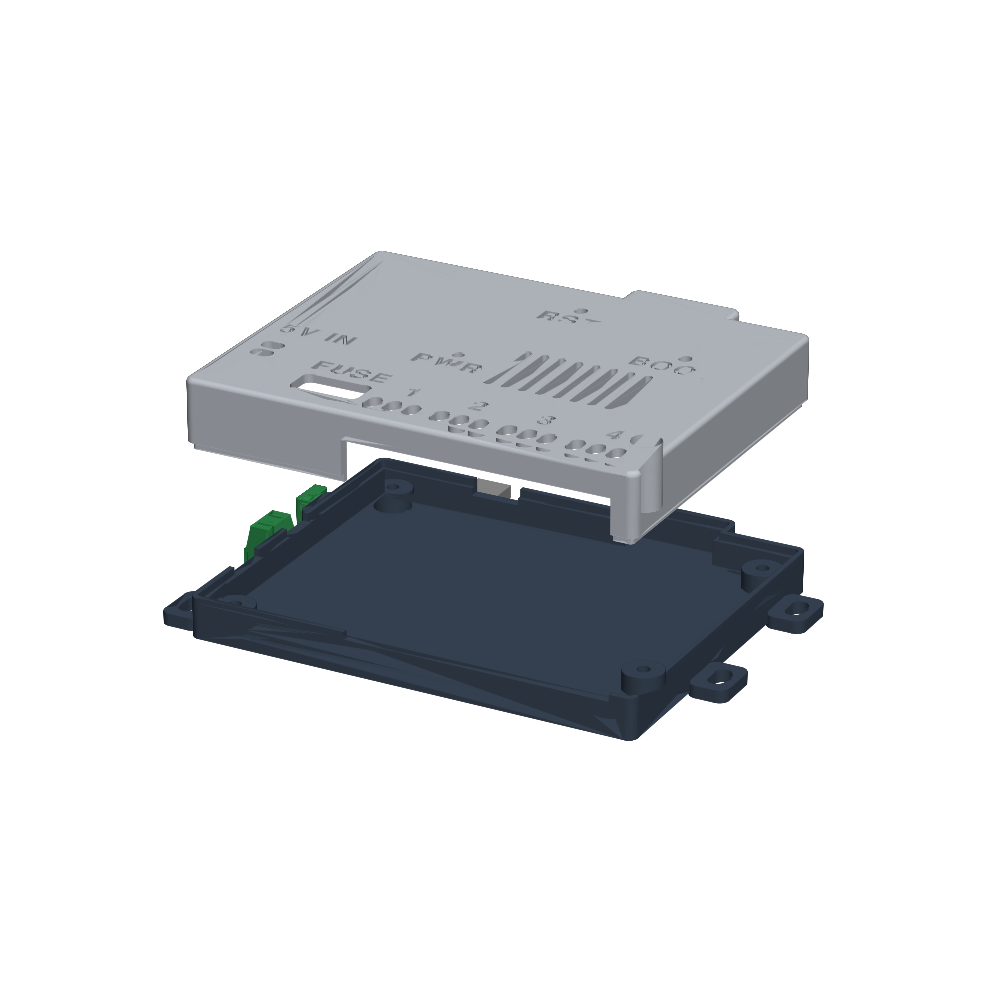

# ESP32 WS2812B LED Controller

A 4-output, 5 V addressable LED controller built around the ESP32-S3-WROOM-1, designed to run [WLED](https://kno.wled.ge/). The repo holds the KiCad design, a 3D-printable enclosure, and the build and programming docs.



## Features

- **ESP32-S3-WROOM-1** (N8 or N8R8) with Wi-Fi, flashed over native USB-C. No USB-UART chip needed.
- **4 LED outputs** (GPIO4–7) through a 74AHCT125 3.3 V → 5 V level shifter, each on a 3-pin terminal (+5V / DATA / GND).
- **5 V input up to 10 A** through a screw terminal, plus a barrel jack (≤5 A), protected by a 7.5 A blade fuse and an SMBJ5.0A TVS diode.
- USB-C powers the logic for programming, isolated from the LED supply by ORing diodes and a 500 mA PTC.
- RST and BOOT buttons, a backup UART header (J3), and test points on every power rail.
- 110 × 85 mm, 2-layer board with 2 oz copper, laid out for JLCPCB assembly. ERC and DRC are clean (rev 0.2).

## Repository layout

| Path | Contents |
| --- | --- |
| [kicad/](kicad/) | KiCad project: schematic (root plus power, MCU, USB and LED-output sheets), PCB and project library |
| [enclosure/](enclosure/) | Parametric enclosure (CadQuery), printable STL/STEP parts, full assembly STEP and renders |
| [firmware/docs/](firmware/docs/) | Programming guide for WLED and Arduino/PlatformIO |
| [docs/](docs/) | Design plan, layout notes, enclosure design and images (each as Markdown and PDF) |
| [tools/kigen/](tools/kigen/) | Python scripts that generate the schematic sheets and PCB |

## Documentation

- [PCB design plan](docs/PCB_DESIGN_PLAN.md): why an ESP32, requirements, schematic blocks and BOM
- [Schematic and layout notes](docs/PCB_LAYOUT_NOTES.md): rev 0.2 status, changes, review fixes and the pre-order checklist
- [Enclosure design](docs/ENCLOSURE_DESIGN.md): how to view, print, order and assemble the enclosure
- [Programming guide](firmware/docs/PROGRAMMING_GUIDE.md): flashing WLED or your own code, pin map and troubleshooting

## Quick start

1. **Build the board:** open `kicad/esp32_led_controller.kicad_pro` in KiCad, then export Gerbers, BOM and positions for ordering. See [Check before ordering](docs/PCB_LAYOUT_NOTES.md#check-before-ordering).
2. **Print the enclosure:** print `enclosure/enclosure_base.stl`, `enclosure/enclosure_lid.stl` and two `enclosure/button_plunger.stl`. You'll also need four M3 screws and heat-set inserts ([parts list](docs/ENCLOSURE_DESIGN.md#parts-to-buy)).
3. **Flash WLED:** connect USB-C and use the WLED web installer ([guide](firmware/docs/PROGRAMMING_GUIDE.md#option-a-wled-recommended)). Set the LED outputs to GPIO 4, 5, 6 and 7.

## Regenerating

From the project root:

```bash
python3 -I tools/kigen/design.py     # rewrite the four schematic sub-sheets
# Do not run tools/kigen/pcbgen.py: it rebuilds the board and discards all routing.
python3 enclosure/enclosure.py       # rebuild the enclosure STL/STEP parts
python3 enclosure/make_assembly.py   # rebuild the assembly STEP files
```

Before you run these, read the Regenerating sections in [PCB_LAYOUT_NOTES.md](docs/PCB_LAYOUT_NOTES.md#regenerating) and [ENCLOSURE_DESIGN.md](docs/ENCLOSURE_DESIGN.md#regenerating) for the dependencies and caveats.

## Status

Rev 0.2: the design is complete and the board has not been fabricated yet.
