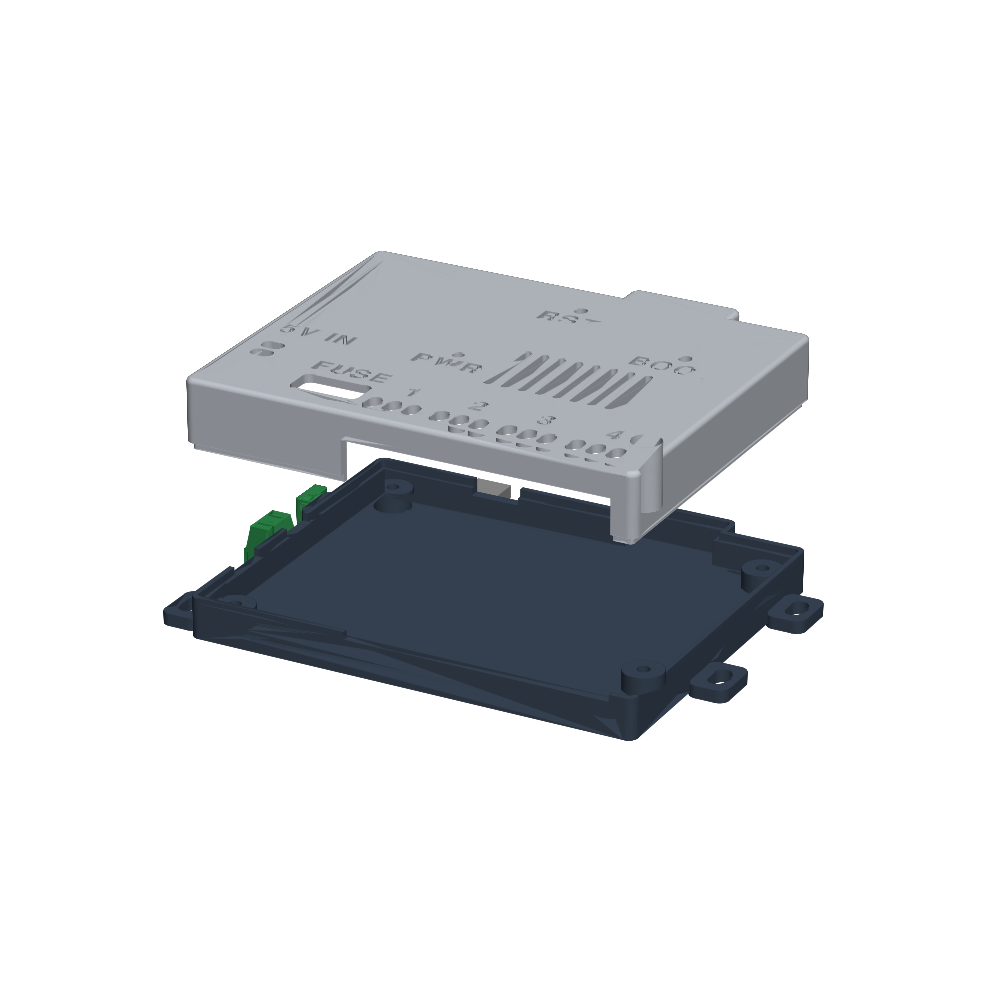
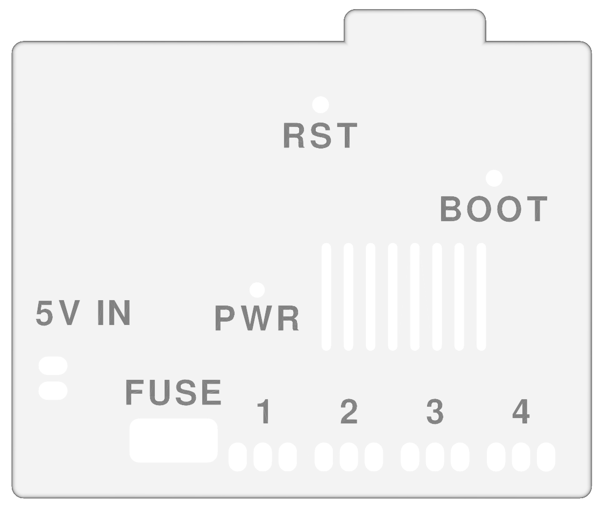
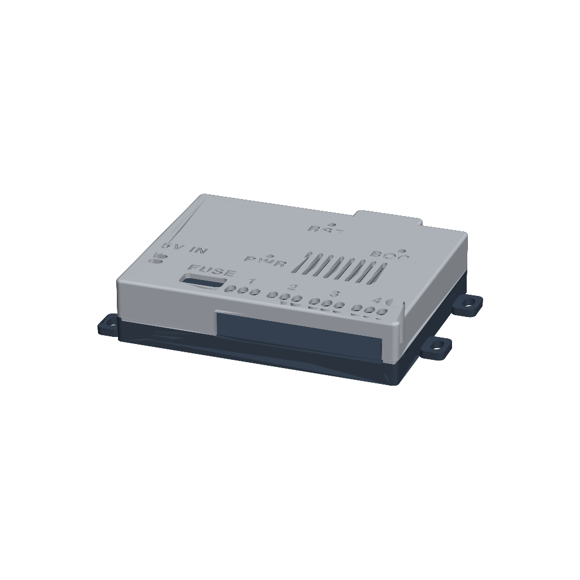
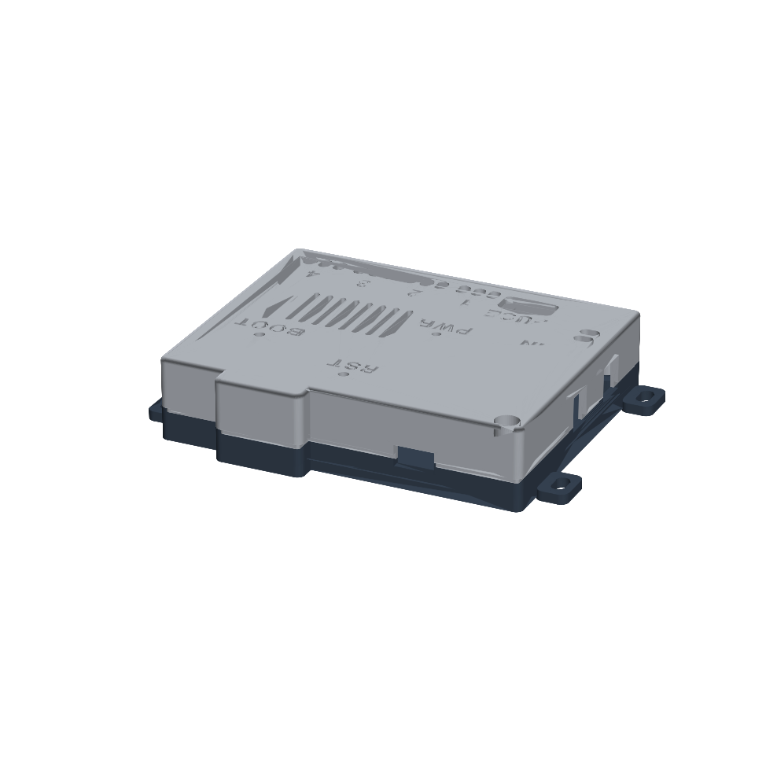
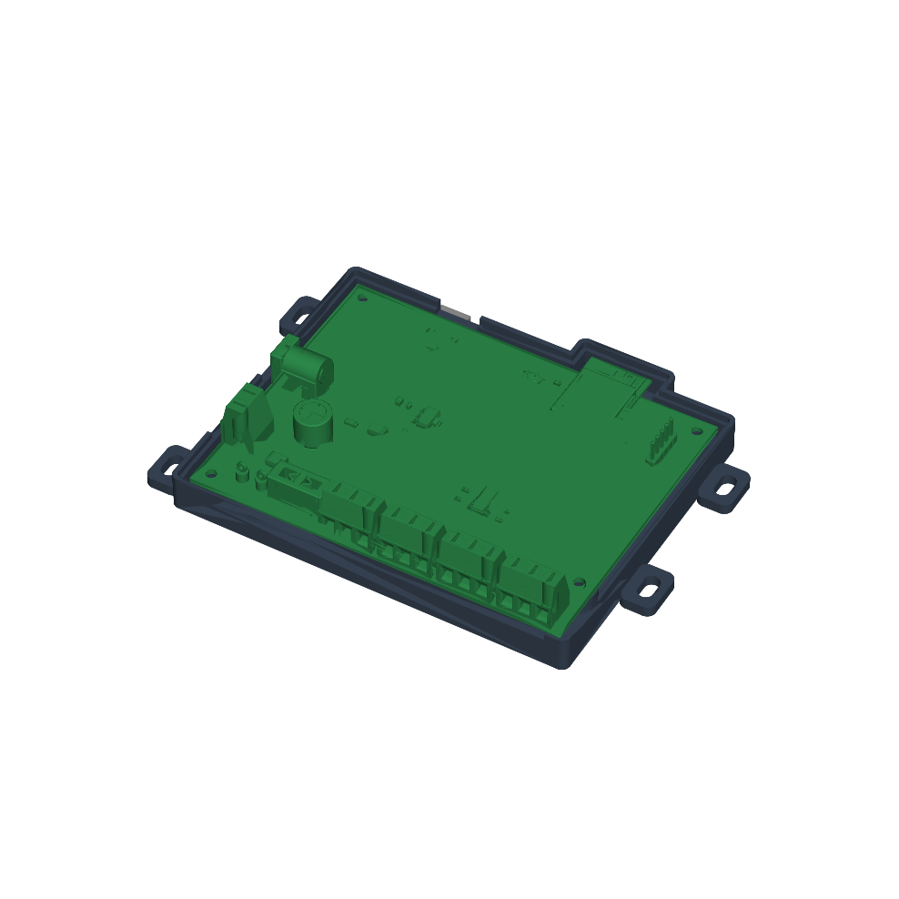
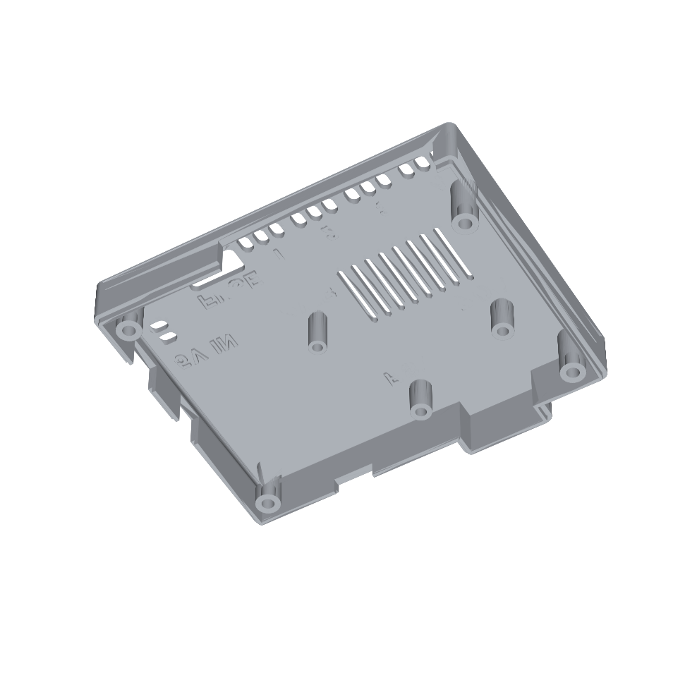

# ESP32 WS2812B Controller — Enclosure (rev 0.2)

Oct 30, 2026 · Fits PCB rev 0.2 (110 × 85 mm) · Source: [enclosure/enclosure.py](../enclosure/enclosure.py)

## Summary

The enclosure is a two-part box for 3D printing: a base tray and a lid. Four M3 screws go in from underneath, through the base, through the PCB's mounting holes and into heat-set inserts in the lid. Each screw clamps the board between a base boss and a lid post, so one set of screws holds the whole stack together. The top stays clean.

Every connector stays usable with the lid on: USB-C, the barrel jack, the 5 V input terminal, the four LED outputs and the fuse. The terminal screws and both buttons are reachable through the lid.

I checked the design against the KiCad 3D model of the board. The base, the lid and both button plungers clear every component, and the lid and base do not overlap.



## Files

All files are in the [enclosure/](../enclosure/) folder.

| File | What it is |
| --- | --- |
| `enclosure_assembly.step` | **Everything together, closed:** PCB with components, base, lid and both plungers, each in its own colour |
| `enclosure_assembly_exploded.step` | Same, with the lid lifted 40 mm and the PCB 20 mm, to see inside |
| `enclosure_base.stl` / `.step` | Base, for printing or ordering |
| `enclosure_lid.stl` / `.step` | Lid, for printing or ordering |
| `button_plunger.stl` / `.step` | Button plunger, 2 needed |
| `enclosure.py` | Parametric model that generates the parts |
| `make_assembly.py` | Builds the two assembly files from the parts and the KiCad board |
| `render_*.png` | Preview images |

## Viewing the files

### All parts together

Open `enclosure/enclosure_assembly.step`, or the `_exploded` version, in one of these viewers.

**FreeCAD (desktop, free)**

1. Install it: `sudo apt install freecad` (Debian 13 ships FreeCAD 1.0).
2. Open the file with **File → Open**. If FreeCAD asks how to import, accept the defaults.
3. The model tree on the left lists `base`, `pcb`, `lid`, `plunger_1` and `plunger_2`. Select one and press **Space** to hide or show it.
4. To see through the lid, select `lid`, then in the **Properties** panel under **View**, set **Transparency** to about 70.
5. To cut the model open, use **View → Clipping plane**.
6. Press **V, F** to fit the view. Drag with the middle mouse button to rotate, or change the navigation style at the bottom right.

**Web browser (no install)**

1. Go to [3dviewer.net](https://3dviewer.net), the Online 3D Viewer.
2. Drag the STEP file onto the page. It loads in your browser and nothing is uploaded to a server.
3. The mesh list on the left lets you hide individual parts.

The STEP files are about 19 MB, so they take a few seconds to load.

KiCad can't open these STEP files. Its 3D viewer (Alt+3 in the PCB editor) shows only the board.

### Single parts

The STLs open in any slicer: PrusaSlicer, OrcaSlicer, Bambu Studio or Cura. Slicers can also open several STLs at once to lay them out on the print bed. 3dviewer.net and FreeCAD open STLs too.

### Rebuilding after changes

```
python enclosure/enclosure.py      # parts (STEP + STL)
python enclosure/make_assembly.py  # combined assembly files (needs kicad-cli)
```

## Size

| | Size |
| --- | --- |
| Body | 117.8 × 99.3 × 26.6 mm (the 99.3 includes the antenna bay) |
| Width across the wall-mount ears | 137.8 mm |
| Base height | 10.6 mm (8.6 mm wall + 2 mm alignment tongue) |
| Lid height | 18.0 mm |
| Inside clearance above the PCB | 16 mm. The tallest parts are the terminal blocks at 13.8 mm |
| Gap between PCB edge and wall | 1.5 mm |
| Space under the PCB | 5 mm. THT leads stick out about 2.3 mm |

## Openings

| Feature | Where | Opening |
| --- | --- | --- |
| USB-C (J6) | Top edge, x = 30 mm | 13 × 7 mm, big enough for a typical plug overmold. The receptacle face sits 2.4 mm behind the outer wall |
| Barrel jack (J2) | Left edge | Full jack face plus 0.6 mm |
| 5 V screw terminal (J1) | Left edge | Wire window 11 mm tall, plus two screwdriver slots in the lid |
| LED outputs (J4, J5, J7, J8) | Bottom edge | One wire window across all four, 11 mm tall, plus 12 screwdriver slots in the lid, numbered 1–4 |
| Fuse (F1) | Lid, front left | 18 × 9 mm window. The mini blade fuse stands taller than the lid, and you can change it without opening the box |
| Reset (SW1), Boot (SW2) | Lid | Guide tube with a captive printed plunger |
| Power LED (D4) | Lid | 3.2 mm hole with a sleeve that reaches down to 3 mm above the LED. Fit a 3 mm light pipe or a clear printed plug |
| Vents | Lid centre | 8 slots, 2 × 22 mm |
| ESP32 antenna | Top edge, x = 66–90 mm | The wall steps out to y = 93 mm around the 6 mm module overhang. Only plastic surrounds the antenna |

The lid has engraved labels: 5V IN, PWR, RST, BOOT, FUSE and the output numbers 1–4. The letters are 7 mm tall, with strokes about 0.9 mm wide, cut 0.8 mm deep, and spaced at least 1.2 mm apart, to meet JLC3DP's 0.8 mm minimum for text.







## How it goes together

- **Split line:** at the PCB's top surface. Every connector sits above it, so the openings are notches open at the lid's lower edge, and the lid drops straight down over the connectors.
- **Alignment:** a 1.2 × 2 mm tongue on the outer edge of the base rim fits a matching recess in the lid, with 0.2 mm clearance.
- **Base bosses:** Ø10 mm, 5 mm tall, with a Ø3.4 mm through-hole and a Ø6.5 × 3 mm counterbore underneath for the screw head.
- **Lid posts:** Ø7.5 mm. They press down on the PCB around each mounting hole and take an M3 heat-set insert (Ø4.0 hole, 7 mm deep).
- **Base underside:** four 9 mm recesses, 0.6 mm deep, for stick-on rubber feet.
- **Wall mounting:** four ears with 4.5 mm slots, placed clear of the input connectors. Set `EARS = False` to remove them.





## Parts to buy

| Qty | Part |
| --- | --- |
| 4 | M3 × 12 socket-head cap screw (ISO 4762) |
| 4 | M3 heat-set insert, 5.7 mm long, for a Ø4.0 mm hole (for example Ruthex M3×5.7). If yours differ, change `INSERT_D` and `INSERT_DEPTH` |
| 4 | 8 mm stick-on rubber feet (optional) |
| 1 | 3 mm light pipe about 17 mm long, or a clear printed plug (optional) |

## Printing

| Part | File | Orientation | Qty |
| --- | --- | --- | --- |
| Base | `enclosure/enclosure_base.stl` | Floor on the bed | 1 |
| Lid | `enclosure/enclosure_lid.stl` | Upside down, top on the bed | 1 |
| Button plunger | `enclosure/button_plunger.stl` | Upright, collar on the bed | 2 |

- No supports are needed in these orientations.
- **Material:** PETG or ASA. PLA works indoors, but it softens near warm parts, and the 10 A path and the fuse do get warm.
- **Avoid carbon-fibre or metal-filled filament.** It detunes the ESP32 antenna.
- **Settings:** 0.2 mm layers, 3 perimeters, 20% infill.
- STEP files are next to the STLs, for editing in other CAD tools.

## Ordering from JLCPCB (3D printing)

JLCPCB's 3D-printing service (JLC3DP) uses the same account as your PCB orders. You can open it from the **3D Printing** tab on jlcpcb.com or at jlc3dp.com. Menus and prices change, so check the live quote page.

### Choosing a material

| Process / material | Good for this enclosure? | Notes |
| --- | --- | --- |
| **MJF, PA12 nylon** | **Recommended** | Strong, slightly flexible and heat-tolerant. Heat-set inserts melt in properly. Comes in matte grey; dyed black is often offered |
| SLA resin (for example 9600 or 8001) | Looks good, weaker | Smooth, crisp labels. **Heat-set inserts don't work in resin.** Use press-in or epoxy-glued M3 inserts instead. Resin is brittle at the screw posts and the ears |
| FDM (PLA, PETG and others), if listed | OK | Cheapest. Choose PETG or ASA over PLA |

Don't choose carbon-fibre-filled or metal materials. They block or detune the Wi-Fi antenna.

### Steps

1. **Log in** at jlcpcb.com and open **3D Printing → Order now** (or go to jlc3dp.com).
2. **Upload** `enclosure_base.stl`, `enclosure_lid.stl` and `button_plunger.stl` from the `enclosure/` folder. The STEP versions are also accepted.
3. **Check the units and size** on each preview. They must read millimetres and match:
   - base 137.8 × 99.3 × 10.6 mm
   - lid 117.8 × 99.3 × 18.0 mm
   - plunger 5.6 × 5.6 × 17.2 mm
4. **Pick the material** for each part, using the table above. MJF PA12 is the default choice.
5. **Pick the colour and finish.** Standard finish is fine. Sanding or dyeing is optional.
6. **Set quantities:** base 1, lid 1, plunger 2. Add spare plungers if they're cheap, because they're small and easy to lose.
7. **Threaded inserts:** if the order page offers insert installation, ask for 4 × M3 inserts in the four holes (Ø4.0 mm) at the bottom of the lid posts, and describe them in the order notes. Otherwise press them in yourself (see Assembly).
8. **Add to cart.** If you're ordering the PCB or PCBA at the same time, pay for everything in one checkout so it can ship together.
9. **Wait for the file review.** JLC checks printability and emails you about any problem. Rev 0.2 already includes the fixes from JLC3DP's first review (see Revision history). Apart from the letter notches, the thinnest feature is the lid's 1.0 mm alignment skirt. If they flag it as too thin, approve it or set `FIT = 0.1` and regenerate, which thickens the skirt to 1.1 mm.
10. **Pay and track the order** under **Order History**.

**Fit with MJF:** MJF parts vary by about ±0.3 mm. If the lid is tight on the base, sand the tongue lightly. Or, before ordering, set `FIT = 0.3` in `enclosure.py` and regenerate. That also thins the skirt to 0.9 mm, so the file review may flag it.

## Assembly

1. Press the four heat-set inserts into the lid posts with a soldering iron at about 220 °C.
2. Drop the two plungers into the RST and BOOT tubes from inside the lid, collar end down.
3. Set the PCB on the four base bosses.
4. Lower the lid straight down so the connectors pass through their notches.
5. Turn the box over. Drive the four M3 × 12 screws through the base and the PCB into the inserts. Snug is enough; over-tightening cracks the posts.
6. Stick on the feet, or screw the ears to a wall.

## Before printing

- **USB-C fit:** the KiCad library has no 3D model for the HRO TYPE-C-31-M-12, so the check used a box sized from the datasheet (8.94 × 3.26 mm shell). Make sure your cable's plug overmold fits the 13 × 7 mm opening. Thick overmolds may need it widened (`connector_cuts()` in the script).
- **Board loose without the lid:** the PCB isn't screwed down while the lid is off. It sits on the bosses and only the lid clamps it.
- **Fuse height wasn't modelled:** the fuse holder model has no fuse in it. The lid window allows for any fuse height.
- **Untested print:** this design hasn't been printed yet. Print the base first and check the PCB fit. All clearances are parameters at the top of `enclosure.py`; `FIT` sets the lid-to-base clearance.
- **Strain relief:** the LED output wires leave through one wide window, so tie them down outside the box for strain relief.

## Regenerating

The model is parametric. To rebuild after changing a dimension:

```
python enclosure/enclosure.py
```

This needs CadQuery 2.x (`pip install cadquery`). It rewrites the STEP and STL files in `enclosure/`. Then run `python enclosure/make_assembly.py` to refresh the combined assembly files. If the PCB changes, update the board data at the top of the script; all positions use the board's bottom-left corner as the origin.

## Revision history

### Rev 0.2 (Oct 30, 2026): fixes from JLC3DP's engineering review

JLC3DP's review flagged two problems:
- **Base:** walls of 0.25 mm at the four screw bosses.
- **Lid:** engraved text 0.38 mm thick. Their minimum for resin and nylon is 0.8 mm.

What changed:

- **Base bosses:** Ø7 → Ø10 mm. The screw-head counterbore (Ø6.5 mm) had left only a 0.25 mm wall; it is now 1.75 mm.
- **Lid labels:** bigger and deeper. Size 3 → 7 mm, depth 0.6 → 0.8 mm, bold, with strokes about 0.9 mm wide. Letters are now placed one at a time with 1.2 mm of plastic between them. The output labels OUT1–OUT4 became the digits 1–4, because the longer text no longer fit between the screw-slot groups.
- **Checks:**
  - A ray-cast wall-thickness scan now finds no wall under 0.8 mm in the base (minimum 1.2 mm) or the plungers (minimum 1.5 mm).
  - The lid's only remaining spots under 0.8 mm are the sharp inner corners of the letters W, V, N, R and 4, where two strokes meet in a V. Every font has these, and at worst the very tip rounds over.
  - The collision check against the board still shows no collisions.

### Rev 0.1 (Oct 30, 2026)

First release.
