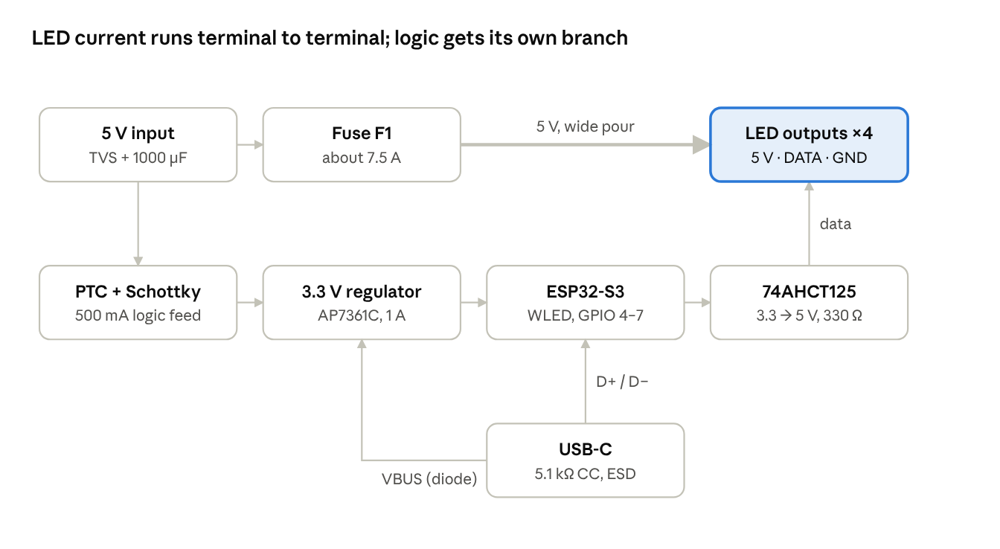

# ESP32 WS2812B LED Controller — PCB Design Plan

Oct 20, 2026 · Living version: https://claude.ai/code/artifact/8fbe1753-9e04-4362-8150-d0b8f8c71896

## Summary

Build a 5 V WS2812B controller around an ESP32-S3-WROOM-1 module running WLED. A single-board computer such as a Raspberry Pi is not needed for this job and makes the board worse. The board takes 5 V from a screw terminal, drives up to 4 LED outputs through a 74AHCT125 level shifter, and is flashed over native USB-C.

The original draft was mostly sound. This version fixes four errors that would have caused a respin: an undersized reverse-polarity MOSFET, missing USB-C CC resistors and power ORing, a too-small reset capacitor, and floating level-shifter enable pins.

## Controller choice

Use an ESP32-family microcontroller, not a single-board computer. WS2812B needs a strict 800 kHz waveform, and the ESP32 generates it in hardware (RMT/I2S peripherals). It boots in under a second and can lose power at any moment without harm. WLED, the firmware you plan to use, runs only on ESP32 and ESP8266.

| Option | Fits this board? | Why |
| --- | --- | --- |
| ESP32-S3-WROOM-1 | Recommended | Native USB removes the USB-UART chip and transistors. More RAM than the classic ESP32. WLED supported. |
| ESP32-WROOM-32E (classic) | Good alternative | The most-tested WLED target. Choose it if you want wired Ethernet (LAN8720 PHY) or more parallel outputs. Needs a CH340C/CP2102N for USB. |
| ESP32-C3 | Budget option | Cheapest, single core, fewer hardware LED channels. Fine for 1–2 outputs. |
| ESP8266 | Not recommended | Low RAM, 1–2 outputs, older WLED builds only. |
| Raspberry Pi Pico W (RP2040) | Only for custom code | PIO drives LEDs very well, but WLED does not run on it. |
| Raspberry Pi 4/5, other Linux SBCs | No | Needs an SD card that can corrupt on power loss, 20–40 s boot, 3–5 W idle draw, and Linux is not real-time, so it needs workarounds to drive WS2812B timing. |

When an SBC does make sense: as a show controller running Falcon Player (FPP) or xLights scheduling, sending E1.31/DDP data over the network to ESP32 boards like this one. It sits upstream; it does not replace the LED driver.

## Requirements

The board is sized for about 100 LEDs at full white per output path, with longer strips powered by injection at the strip.

| Item | Target |
| --- | --- |
| LED type | WS2812B (5 V, 800 kHz single-wire data) |
| Supply | 5 V DC, screw terminal, up to 10 A through the board |
| Current per LED | about 60 mA at full white, about 1 mA when off |
| LED outputs | 4, each with data, 5 V and GND |
| Connectivity | Wi-Fi; USB-C for flashing and logs |
| Firmware | WLED (default); FastLED or Adafruit NeoPixel for custom code |
| Assembly | SMD, 0603/0805 passives, JLCPCB or PCBWay PCBA |

## Schematic blocks

### MCU: ESP32-S3-WROOM-1 (N8 or N8R8)

- EN (reset): 10 kΩ pull-up to 3.3 V plus 1 µF to GND, per Espressif's hardware design guidelines. Tactile reset button to GND.
- GPIO0 (boot): 10 kΩ pull-up, tactile BOOT button to GND.
- LED data pins: GPIO4, 5, 6, 7. Avoid the strapping pins (0, 3, 45, 46), the USB pins (19, 20), the flash pins (26–32) and, on R8 modules, the PSRAM pins (33–37).
- Decoupling: 22 µF plus 100 nF ceramic at the module's 3V3 pin.

### USB-C and programming

- USB D−/D+ go straight to GPIO19/20. The S3's built-in USB-Serial-JTAG flashes and resets the chip, so no CH340C, CP2102N or auto-reset transistors are needed.
- CC1 and CC2 each get their own 5.1 kΩ pull-down to GND. Without them, USB-C chargers and C-to-C cables supply no power.
- ESD: USBLC6-2SC6 on D−/D+ and VBUS.
- VBUS feeds the 3.3 V rail only, through a Schottky diode (SS14 or similar). It never feeds the LED outputs.

### Power input and protection

- 5 V screw terminal rated 10 A or more.
- High-current LED path: terminal → fuse → output terminals, on wide copper. The fuse (blade or SMD, about 7.5 A) is sized to protect the output wiring.
- Reverse polarity on the LED path: a low-R P-MOSFET (under 10 mΩ, DPAK or PowerPAK), or skip it and use a keyed connector. A SOT-23 FET like the AO3401A will overheat at these currents.
- Logic branch: 500 mA PTC → Schottky diode (ORed with USB VBUS) → 3.3 V regulator. This also prevents back-feeding a PC's USB port from the 5 V supply.
- TVS diode SMBJ5.0A across the 5 V input.
- 1000 µF / 16 V low-ESR electrolytic across the 5 V input. Avoid tantalum capacitors on the input; they can fail short on hot-plug surges.

### 3.3 V regulation

- AP7361C-33 (1 A, low dropout) or a small buck converter. The AP2112K (600 mA) leaves too little margin for Wi-Fi current peaks, and the AMS1117 (about 1.1 V dropout) is marginal after the input diode.
- 10 µF ceramic in and out, plus 100 nF.

### Level shifting and outputs

- 74AHCT125 powered from 5 V, with 100 nF at its VCC pin. Its 2.0 V input threshold accepts 3.3 V logic.
- Tie all four OE pins to GND (they are active-low). Tie any unused input to GND.
- 330 Ω series resistor at each buffer output, at the source end of the trace.
- Each output connector carries data, 5 V and GND.

## Corrections to the original plan

Four items in the original draft would have caused a failed board. The rest are improvements.

| Severity | Original | Problem | Fix |
| --- | --- | --- | --- |
| Must fix | AO3401A reverse-polarity FET + 5 A PTC on the LED path | About 50 mΩ at 6 A is about 1.8 W in SOT-23, and both parts add voltage drop | Fuse on the LED path; PTC and FET only on the logic branch, or a FET under 10 mΩ |
| Must fix | USB-C with no power handling | No CC resistors means no 5 V from USB-C chargers; the supply back-feeds the PC | 5.1 kΩ on each CC pin; Schottky diode ORing |
| Must fix | EN: 10 kΩ + 0.1 µF | Marginal reset delay on slow supply ramps | 10 kΩ + 1 µF |
| Must fix | 74AHCT125 OE pins not specified | Active-low OE left floating gives no data output | OE and unused inputs to GND |
| Should fix | ESP32-WROOM-32E + CH340C + 2 transistors | Extra parts the S3 does not need | ESP32-S3 native USB |
| Should fix | AMS1117 or AP2112K | High dropout or only 600 mA | AP7361C or a buck converter |
| Should fix | Decoupling only at the regulator | Wi-Fi current peaks at the module | 22 µF + 100 nF at the module's 3V3 pin |
| Should fix | Tantalum on the 5 V input | Can fail short on hot-plug | Ceramic or electrolytic |
| Should fix | Series resistor at the output terminal | Source termination only works at the driver | Resistor at the buffer output |
| Should fix | One LED output | 3 buffer channels unused | 4 outputs |
| Should fix | No surge or ESD protection | Hot-plug spikes and long data wires | SMBJ5.0A on 5 V, USBLC6-2 on USB |
| Should fix | Ground pour on both layers, no current plan | 6 A LED return current flows under the ESP32 | Separate LED current loop, single-point logic ground |

## Block diagram

The thick line is the only high-current path: input to fuse to outputs. The ESP32 and buffer draw from a separate protected branch that USB-C can also power.

## Bill of materials

Part numbers are suggestions; check stock in the JLCPCB/LCSC parts library before layout.

| Ref | Part | Qty | Package | Notes |
| --- | --- | --- | --- | --- |
| U1 | ESP32-S3-WROOM-1-N8 (or N8R8) | 1 | Module | Antenna off the board edge |
| U2 | AP7361C-33E 3.3 V LDO | 1 | SOT-223 | 1 A |
| U3 | 74AHCT125 quad buffer | 1 | SOIC-14 / TSSOP-14 | Powered from 5 V |
| U4 | USBLC6-2SC6 ESD array | 1 | SOT-23-6 | USB lines |
| J1 | 5 V input screw terminal | 1 | 5.08 mm, 2-pin | Rated 10 A or more |
| J2–J5 | LED output terminal (5 V, DATA, GND) | 4 | 3.5/5.08 mm, 3-pin | |
| J6 | USB-C receptacle, 16-pin | 1 | SMD | USB 2.0 only |
| F1 | Fuse, about 7.5 A | 1 | Blade holder or SMD 2410 | LED path |
| F2 | PTC 500 mA hold | 1 | 1206 | Logic branch |
| D1, D2 | Schottky SS14 | 2 | SMA | 5 V / VBUS ORing |
| D3 | TVS SMBJ5.0A | 1 | SMB | Across 5 V input |
| C1 | 1000 µF / 16 V low-ESR electrolytic | 1 | Radial or SMD can | 5 V input bulk |
| C2–C4 | 10 µF ceramic | 3 | 0805 | LDO in/out |
| C5 | 22 µF ceramic | 1 | 0805 | Module 3V3 |
| C6–C9 | 100 nF ceramic | 4 | 0603 | Decoupling |
| C10 | 1 µF ceramic | 1 | 0603 | EN delay |
| R1, R2 | 10 kΩ | 2 | 0603 | EN, GPIO0 pull-ups |
| R3, R4 | 5.1 kΩ | 2 | 0603 | USB-C CC1, CC2 |
| R5–R8 | 330 Ω | 4 | 0603 | Data series resistors |
| SW1, SW2 | Tactile switch | 2 | SMD | RESET, BOOT |
| D4 | Power LED + 1 kΩ | 1 | 0603 | Optional |

## PCB layout guidelines

1. Order 2 oz copper on a 2-layer board. It roughly halves the trace width needed for high current.
2. LED power path: route 5 V and GND from the input terminal to the output terminals as wide pours. On 1 oz copper, 6 A needs about 3.5–5 mm; on 2 oz, about 2–2.5 mm. Stitch top and bottom pours with many vias.
3. Keep the LED return current away from the ESP32. Route the high-current loop terminal to terminal, and join logic ground to it at one point near the input.
4. Antenna: the module's antenna overhangs the board edge, with no copper, traces or parts beneath it on any layer. Follow the keep-out in the module datasheet.
5. Decoupling: 100 nF capacitors within 2 mm of the module's 3V3 pin and the 74AHCT125 VCC pin, with a via straight to ground.
6. The 1000 µF capacitor and TVS sit right at the input terminal.
7. Data traces: short, from the buffer to the output connector, with the 330 Ω resistor at the buffer end and ground pour on both sides.
8. USB D+/D− as a short, matched pair with the ESD array near the connector.
9. Silkscreen: label polarity on every terminal and the pin order (5 V / DATA / GND) on each output.

Tools: EasyEDA if ordering PCBA directly from JLCPCB; KiCad otherwise (with the JLCPCB fabrication plugin).

## Firmware and bring-up

Flash WLED's ESP32-S3 build over USB-C with the WLED web installer, then configure the outputs in LED Preferences.

- [ ] Before power: check for shorts between 5 V, 3.3 V and GND with a multimeter
- [ ] Power from a current-limited bench supply (5 V, 500 mA limit); 3.3 V rail reads 3.25–3.35 V
- [ ] Board enumerates over USB-C with a C-to-C cable (confirms the CC resistors)
- [ ] With the 5 V supply on and USB attached, no voltage back-feeds onto the USB port
- [ ] Flash WLED; set outputs to GPIO 4, 5, 6, 7
- [ ] Set WLED's automatic brightness limiter to the supply's real current rating
- [ ] Scope the data line at an output: clean 0–5 V edges at 800 kHz
- [ ] Drive a short strip, then a full 100-LED strip at full white; check that the fuse, traces and terminals stay cool
- [ ] Wi-Fi range test with the board in its enclosure

For runs longer than about 100 LEDs, inject 5 V at the strip every 50–100 LEDs instead of pushing it through the board. A relay or high-side MOSFET on the LED supply, using WLED's relay pin, cuts the roughly 1 mA per LED drawn even when off.

## Open questions

- [ ] How many LEDs in total, and how many separate strips? This sets the output count and the fuse rating.
- [ ] Is wired Ethernet needed? If yes, switch to the classic ESP32-WROOM-32E with a LAN8720 PHY.
- [ ] Any extras on the board: a user button, an IR receiver, an I2S microphone for sound-reactive effects?
- [ ] Enclosure size and mounting holes?
- [ ] Will the board ever run from a 12 V supply? If so, add a buck converter and choose 12 V-rated parts.
