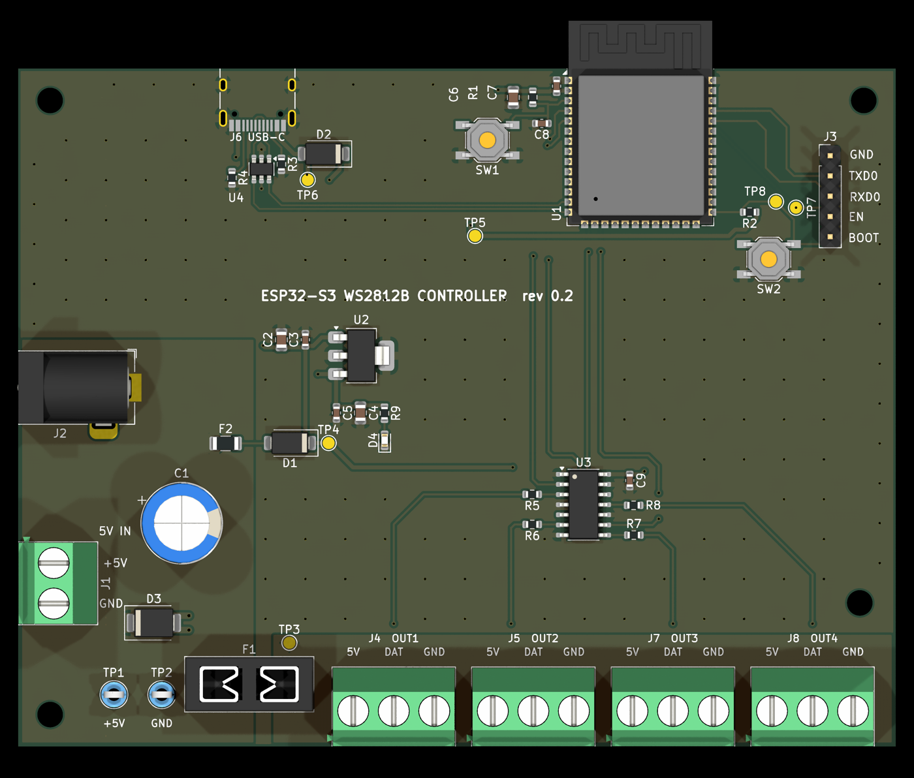

# ESP32 WS2812B Controller — Schematic and Layout Status (rev 0.2)

Oct 29, 2026 · Companion to [PCB_DESIGN_PLAN.md](PCB_DESIGN_PLAN.md)

## Status

| Item | State |
| --- | --- |
| Schematic (4 sheets, 46 parts) | Complete. ERC: 0 violations |
| PCB placement, outline, mounting holes | Complete. 110 × 85 mm, 2 layers, 2 oz copper |
| Power pours (+5V_IN, +5V_LED, GND both layers) | Complete and filled |
| Signal routing | Complete: 0 unconnected items (Oct 29, second review) |
| DRC | 0 errors with JLCPCB 2 oz limits (0.2 mm minimum clearance and track width). 17 expected warnings: connector/module silkscreen past the board edge (16) and a library-version note on U1 (1); exclude them in KiCad's DRC dialog |
| Schematic ↔ PCB parity | 0 issues |

## Changes from the plan and the earlier draft

- **R3, R4 (USB-C CC pull-downs): changed from 10 kΩ to 5.1 kΩ.** 10 kΩ is outside the USB-C spec; chargers and C-to-C cables may not supply power.
- **Kept your part choices:** J2 barrel jack in parallel with J1, and D3 drawn with the PTVS5V0Z1USK symbol but valued SMBJ5.0A in an SMB package (pin 1 = cathode, matches the footprint). U4 is now the USBLC6-2SC6 from the plan (see the second review below).
- **J2 barrel jack:** most jacks are rated 5 A or less, so it can't carry the full 10 A that J1 can.
- **SW1/SW2:** the SW_MEC_5E symbol had no footprint in the KiCad library. Both switches are now SW_Push with an SMD TL3342 footprint, as the plan asked.
- **C6 (module 3V3):** 10 µF → 22 µF per the plan. 10 µF caps moved to 0805.
- **Added from the plan:** F1 7.5 A mini-blade fuse, F2 500 mA PTC, D1/D2 SS14 ORing diodes, power LED (R9 + D4), C9 decoupling at the 74AHCT125, R5–R8 330 Ω, and four output terminals (J4, J5, J7, J8).
- **J3 (5-pin header):** wired as an optional UART/programming header: 1 GND, 2 TXD0, 3 RXD0, 4 EN, 5 IO0. It carries no 3.3 V.
- **TP1/TP2 test points (added):** through-hole Keystone 5005 (red, +5V_IN) and 5006 (black, GND) loops for hook clips, on the power sheet.
- **TP3–TP8 SMD probe pads (added):** 1.5 mm round pads on +5V_LED, +5V_LOGIC, +3V3, VBUS (power sheet) and EN, BOOT (MCU sheet). They are excluded from the BOM.
- **No reverse-polarity FET** on the LED path. Polarity is marked on the silkscreen.

## Board layout

- **ESP32-S3 module (U1):** top right, with the antenna overhanging the top edge. The footprint's antenna keep-out lies entirely off the board.
- **USB-C (J6):** on the top edge, with the U4 ESD array and the CC resistors right behind it.
- **Power inputs:** J2 barrel jack and J1 screw terminal on the left edge, with D3, C1 and F1 next to them.
- **Test points:** TP1 (+5V, in the +5V_IN pour) and TP2 (GND, through-hole to the B.Cu plane) sit side by side between the bottom-left mounting hole and F1, 6 mm apart, with silk labels underneath.
- **SMD probe pads:** TP3 (+5V_LED) sits in the +5V_LED pour beside F1 and is already connected. TP4 (+5V_LOGIC, by C2/C3), TP5 (+3V3, by C4/C5), TP6 (VBUS, by D2), TP7 (EN, by SW1) and TP8 (BOOT, by SW2) each need a short track.
- **LED outputs:** J4/J5/J7/J8 along the bottom edge, with R5–R8 directly above each DATA pin.
- **Copper:**
  - F.Cu `+5V_IN` pour covers the input corner: J1, J2, D3, C1, F1 pad 1 and F2.
  - F.Cu `+5V_LED` pour runs from F1 pad 2 under all four output terminals.
  - GND fills the rest of F.Cu and all of B.Cu, stitched with vias around the edge.
- **Net classes:**
  - LED_Power (+5V_IN, +5V_LED): 2.5 mm tracks.
  - Power (+5V_LOGIC, +3V3, VBUS, GND): 0.5 mm.
  - USB: 0.3 mm.
  - Default: 0.25 mm.

## Fixes applied after review (Oct 29)

- LED data DOUT1–4 drop to B.Cu through a via just above the +5V_LED pour, so the pour is one solid piece under all four terminals.
- R9/D4 net restored to `/Power/PWR_LED`. TP3–TP8 added on their nets.
- U3 pad 4: solid zone connection plus a ground via.
- Silkscreen references moved off pads and away from each other.

## Second review fixes (Oct 29, evening)

- **+5V_LOGIC to U3 restored.** The D1 → TP4 track had been deleted, leaving U3 (74AHCT125) and C9 unpowered, so no LED output would have worked. Re-added as a 0.5 mm track.
- **U4 changed from D3V3XA4B10LP (UDFN-10, 0.5 mm pitch) to USBLC6-2SC6 (SOT-23-6).** The UDFN pads leave 0.15 mm gaps, below JLCPCB's 0.2 mm minimum for 2 oz copper. The USBLC6-2SC6 also protects VBUS. It sits just below J6 with D+/D− passing straight through pins 3→4 and 1→6, a GND via above pin 2 and a VBUS via below pin 5 to the existing B.Cu VBUS track. Schematic and `tools/kigen/design.py` updated to match.
- **Design rules raised to 0.2 mm** minimum clearance and track width, so DRC enforces the 2 oz limits.
- **C7 (100 nF) moved beside U1 pins 1/2** (about 1.5 mm away instead of 5 mm). R1 took C7's old spot; its EN pad has a new short track.
- **Solid zone connections** (no thermal spokes) on J1, J2 pins 1–2, F1, C1 and the 5 V/GND pins of J4/J5/J7/J8, so the 10 A path does not run through thin spokes.
- **127 ground stitching vias** added on a 5 mm grid wherever both layers are solid GND and away from parts.
- Backups: `kicad/esp32_led_controller-backups/before-tp4-fix-20261029.*`, `before-usblc6-20261029.*`.

## Routing checklist

Route in this order with KiCad's interactive router (X).

1. **USB:** D+/D− from J6 through U4 to U1 pins 13/14, as a short, matched pair. J6's A6/B6 and A7/B7 pads join at the connector.
2. **Decoupling:** C6/C7 to U1 pin 2 (3V3) and C9 to U3 pin 14, each with a via straight down to GND.
3. **3.3 V and 5 V logic:** F2 → D1 → +5V_LOGIC, D2 from VBUS. Then U2 in/out with C2–C5, and +3V3 to U1, R1, R2 and R9.
4. **LED data:** U1 IO4–IO7 → U3 inputs, then U3 outputs → R5–R8. From each resistor, drop through a via to B.Cu to cross the +5V_LED pour and reach the DATA pad of its terminal.
5. **EN/BOOT:** R1, C8, SW1, TP7 to U1 pin 3; R2, SW2, TP8 to pin 27; J3 to TXD0/RXD0. Pick up TP4–TP6 while routing their rails.
6. **GND:** give every remaining SMD ground pad a via to the B.Cu plane.
7. **Finish:** refill zones (B), then run DRC until it shows 0 unconnected items.

## Check before ordering

- [ ] Output and input terminals face outward. Check wire entry in the 3D viewer (Alt+3): the layout assumes entry on the footprint's +y side
- [ ] USB-C receptacle opening is flush with the top edge
- [x] AP7361C-33E pinout checked against the Diodes datasheet: SOT223 "E" = 1 IN, 2 GND/tab, 3 OUT, matching the footprint. Buy **-33E-13**, not the **-33ER** (reversed pinout)
- [ ] Your fab accepts the 0.2 mm thermal vias in the ESP32 footprint's ground pad, or remove them
- [ ] Order 2 oz copper; the stackup already specifies 0.07 mm copper
- [ ] Add LCSC part numbers to the symbols if ordering JLCPCB assembly
- [ ] Regenerate the files in `kicad/production/` (the current ones predate the Oct 29 fixes)

## Regenerating

The scripts in `tools/kigen/` produced the schematic sheets and the starting board.

- `python3 -I tools/kigen/design.py` rewrites the four sub-sheets.
- `python3 -I tools/kigen/pcbgen.py` rebuilds the board from the template and **discards any routing**. Routing has started, so don't run it again.

The generator shifts everything by (−13, −42) mm to match where you moved the board in KiCad (`OFFSET` in `pcbgen.py`).

After you start routing, make changes in KiCad instead, using **Tools → Update PCB from Schematic** (F8).

A backup of the project before these changes is at `kicad-backup-20261028-130519.zip`.
